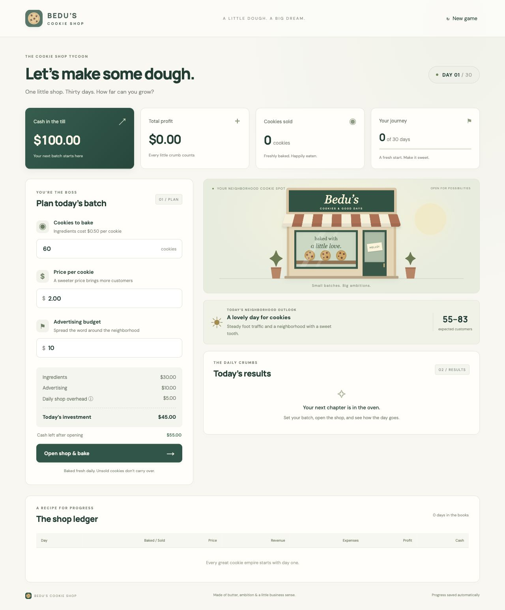
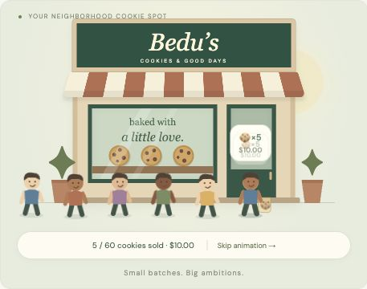

# 🍪 Bedu’s Cookie Shop Tycoon

A small browser game about turning **$100 into a thriving cookie shop in 30 days**. Decide how many cookies to bake, choose your price, and spread the word with advertising. Then watch customers arrive and find out whether your batch paid off.

Built with HTML, CSS, and vanilla JavaScript. No packages, build step, account, or backend required.



## Features

- **30-day business challenge** with daily baking, pricing, and advertising decisions.
- **Changing neighborhood conditions** that affect demand, alongside price, advertising, and a little uncertainty.
- **Budget checks and demand forecasts** to help plan each batch.
- **Animated customers** who visit the shop, buy cookies, and leave with takeaway bags.
- **Daily financial reports** showing cookies sold, revenue, expenses, profit, and remaining cash.
- **Complete shop ledger** and a final summary of your run.
- **Automatic local saves**, so you can return to your shop later.
- **Responsive layout**, keyboard-accessible controls, and reduced-motion support.

## Run locally

### Open directly

Download or clone this repository, then open `index.html` in a modern web browser. That’s all you need to play.

The game works offline. Google Fonts are optional; system fonts are used when the font download is unavailable.

### Use a local server

For a consistent browser address and saved-progress behavior, run a local server from the project folder. With Python 3 installed:

```sh
python3 -m http.server 8000
```

Open **[localhost:8000](http://localhost:8000)** in your browser. Stop the server with `Ctrl+C` when finished.

> Node.js is only needed to run the logic checks. It is not required to play.

## How to play

1. **Plan your batch.** Choose how many cookies to bake, set the price per cookie, and select an advertising budget.
2. **Check your costs.** Review the investment, remaining cash after opening, and expected customer range.
3. **Open the shop.** Watch customers arrive and buy cookies. Use **Skip animation** to jump ahead.
4. **Review your results.** Compare sales, revenue, expenses, and profit in the daily report and ledger.
5. **Plan the next day.** Adjust your strategy and keep baking until day 30—or until you can no longer afford to open.

Your goal is to finish with as much cash as possible. **New game** starts another run after confirmation.

### Costs and rules

| Item | Rule |
| --- | --- |
| Starting cash | $100 |
| Run length | Up to 30 trading days |
| Ingredients | $0.50 per cookie baked |
| Shop overhead | $5 every day, even if you bake no cookies |
| Advertising | Your chosen daily budget |
| Unsold cookies | Discarded at the end of the day |
| Opening the shop | You must afford the entire day’s expenses upfront |
| Early ending | The run ends if cash drops below $5 |

Lower prices tend to attract more customers. Advertising increases demand, with diminishing returns. Neighborhood conditions and daily variation also affect sales, so forecasts are estimates rather than guarantees. Sales can never exceed the number of cookies baked.

### Understanding the numbers

```text
Expenses = (cookies baked × $0.50) + advertising + $5 overhead
Revenue  = cookies sold × price per cookie
Profit   = revenue − expenses
Cash     = previous cash + profit
```

For example, baking **60 cookies**, pricing them at **$2**, and spending **$10 on advertising** costs **$45**. If all 60 sell, you earn **$120 in revenue** and **$75 in profit**, taking your starting cash from **$100 to $175**.

## Customer animations



Visitors buy small batches of cookies. More sales produce more visitors, up to 24 per day, and their purchase quantities add up to the actual number sold. Purchase bubbles show batch sizes and payments, while a live counter tracks sales.

Animations are brief and can be skipped. If your device prefers reduced motion, the game shows the final sales count immediately. The day’s results are saved before the animation begins; refreshing does not charge for or replay the same trading day.

## Saved progress

Progress is stored in your browser’s `localStorage` when available.

- Return using the **same browser and address** to resume your run.
- Saves are local to your device; they do not sync between browsers or devices.
- Clearing browser site data or confirming **New game** resets the saved run.
- If browser storage is unavailable, you can still play for the current session, but progress may be lost on reload.

## Project structure

| File | Purpose |
| --- | --- |
| `index.html` | Page structure, controls, shop illustration, and dialogs |
| `style.css` | Styling, responsive layouts, and customer animations |
| `engine.js` | Demand, costs, validation, sales, and day progression |
| `app.js` | Interface updates, local saves, and customer animation timing |
| `favicon.svg` | Cookie logo and browser favicon |
| `test-engine.js` | Game logic checks using Node’s built-in assertions |
| `preview.png` | Dashboard screenshot |
| `customers-preview.png` | Customer animation screenshot |

## Run the checks

With Node.js installed, run:

```sh
node test-engine.js
```

The checks cover starting cash, pricing and advertising effects, affordability, sales limits, financial calculations, day transitions, 30-day completion, and running out of cash.

To check JavaScript syntax:

```sh
node --check app.js
node --check engine.js
```

## Development

Edit the HTML, CSS, or JavaScript files and refresh your browser to see changes. There are no dependencies to install or generated build files to manage.

Keep business rules in `engine.js` and interface behavior in `app.js`. When changing gameplay, run the logic checks and manually try a trading day, the customer animation and skip button, saved-progress restoration, and a narrow mobile layout.
